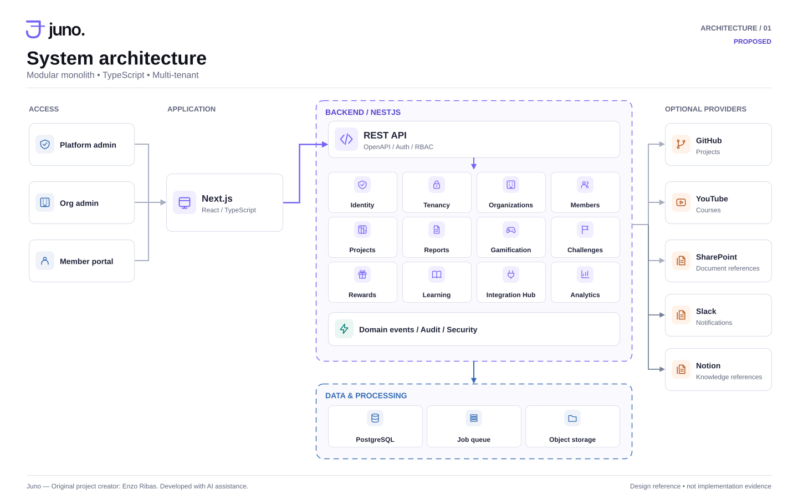

# Juno

**Manage. Engage. Evolve.**

Juno is a community-driven, MIT-licensed Junior Enterprise Management Platform. Its mission is to give Junior Enterprises access to management, organizational development, gamification, and learning tools regardless of their size, budget, or technical experience. Each organization will have its own workspace, members, settings, and branding.

Juno was created by Enzo Ribas and is developed with the assistance of artificial intelligence.

**Free to use. Open to contribute. Built to evolve.**

Juno is designed with the Brazilian Junior Enterprise movement in mind and for international adoption. The official project will keep core functionality freely accessible and support independent self-hosting. Initial application locales are English and Brazilian Portuguese. Source code and official technical documentation use English.

## Project status

The `juno` repository is public and intended for community-driven development. Phase 1 includes an independent web application and REST API. See the [roadmap](ROADMAP.md).

Juno software and associated project documentation use the [MIT License](LICENSE) (SPDX `MIT`). Copyright (c) 2026 Enzo Ribas. See the [licensing decision](docs/architecture/adr/0002-mit-licensing.md) and [proposed brand usage policy](TRADEMARKS.md).

## Proposed architecture

Docker and Docker Compose are required for the planned runtime. See the [architecture diagrams](docs/architecture/diagrams/README.md), [containerized development](docs/development/docker.md), and [self-hosting](docs/deployment/README.md).

## Start here

- [Documentation index](docs/README.md) and [local setup](docs/development/README.md)
- [Product vision and requirements](docs/product/requirements.md) and [architecture evaluation](docs/architecture/overview.md)
- [Contributing](CONTRIBUTING.md) and [GitHub community strategy](docs/governance/community.md)
- [Approved brand identity](docs/design/brand-identity.md) and [brand asset inventory](assets/brand/README.md)
- [Support](SUPPORT.md), [security reporting](SECURITY.md), and [AI disclosure](AI_DISCLOSURE.md)
