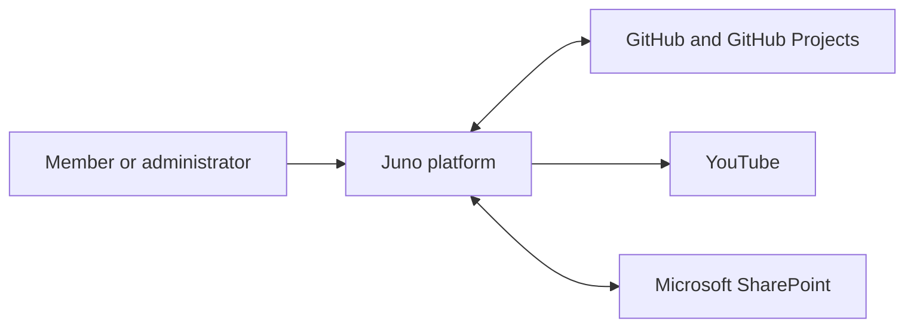
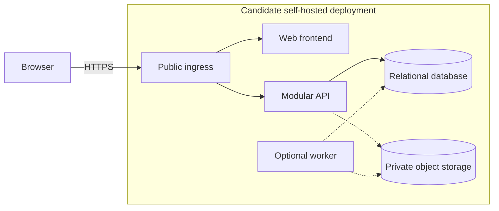
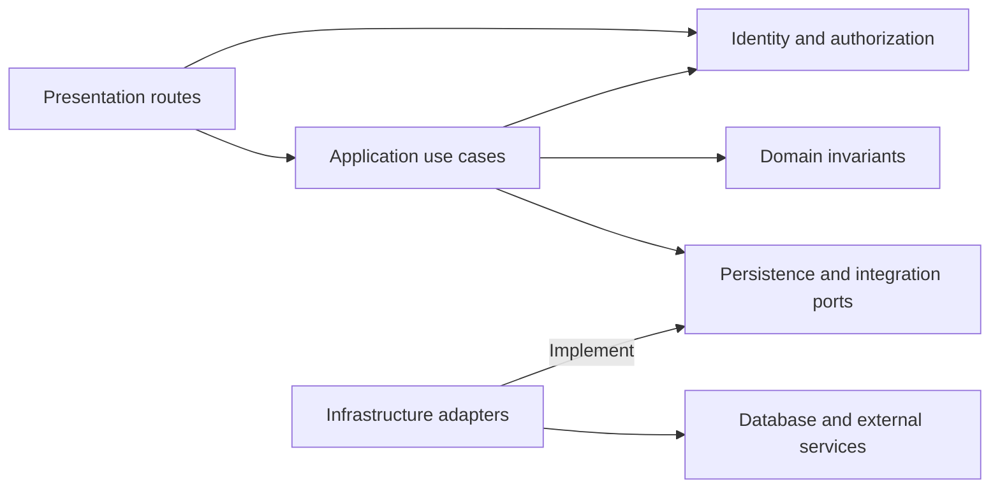
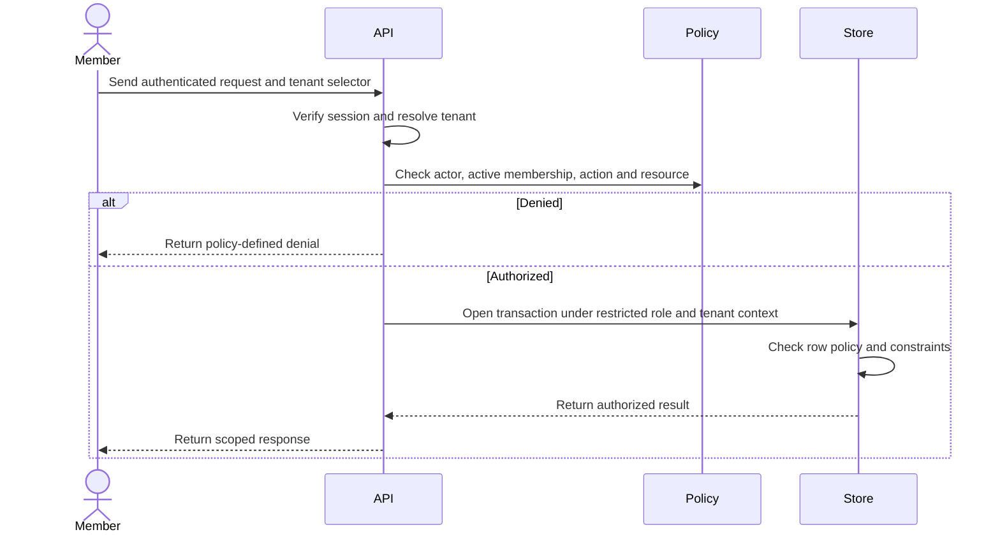
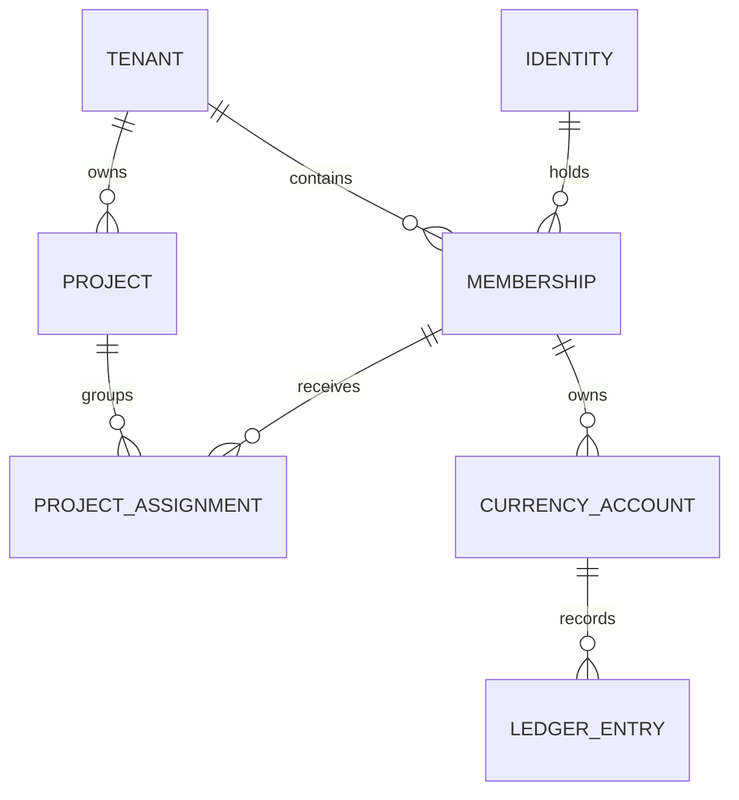
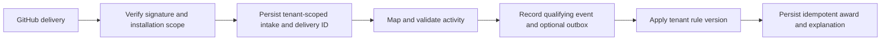
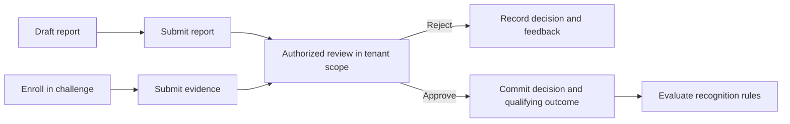
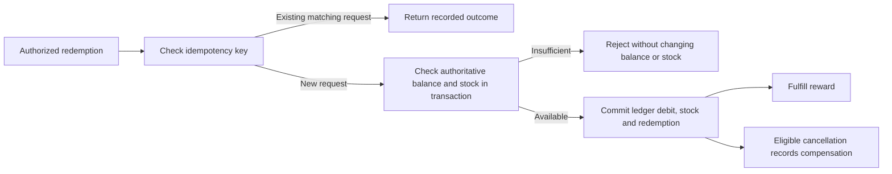

# Architecture diagrams

**Status:** Proposed supporting sketches from JUNO-0001. See the authoritative editable architecture diagrams and the visual documentation standard. Use C4 concepts for context, containers, components and deployment. Use sequences and entity relationships for process and data views. [C4 diagrams](https://c4model.com/diagrams) · [Mermaid reference](https://mermaid.js.org/intro/) · [GitHub diagram rendering](https://docs.github.com/en/get-started/writing-on-github/working-with-advanced-formatting/creating-diagrams)

## System context

Members and scoped administrators use Juno. Optional providers supply authorized contribution, learning and document references.

## Containers and deployment

A self-hosted ingress routes browser traffic. The browser and API may share an origin. The API retains one modular backend, with a separate worker and object storage only where justified. All private data services stay behind the ingress.

## Components

Presentation coordinates authenticated inputs with policy and application use cases. Use cases call domain functions and ports. Adapters implement those ports and contain database and provider details.

## Authentication, authorization and tenant isolation

After validating a session, the server resolves the requested tenant, checks active membership and action scope, and uses a restricted database role with transaction-scoped tenant context. Neither an explicit object ID nor a signed-in session grants tenant access.

## Data relationships

Identity is global. Tenant memberships bind identities to organizations. Projects, accounts and ledger entries use tenant-scoped relationships. The logical model omits implementation-specific columns.

## GitHub integration and domain events

The adapter validates signatures and installation mapping before durable intake. An approved activity crosses an internal contract into recognition. Provider delivery deduplication and reward idempotency cover different boundaries.

## Reports and challenges

Report submission and challenge evidence have distinct eligibility and reviewer checks. Only a committed qualifying decision is eligible for recognition.

## Currency transactions and reward redemption

An authorized use case checks balance, inventory and idempotency in a single transaction. The proposed path shows a debit at approval. Reservation policy remains open. Eligible cancellations use compensating entries.

Review against the [architecture proposal](overview.md), [tenancy requirements](tenancy.md), [integration design](../integrations/README.md), and [business rules](../product/gamification.md). Update each view when an accepted ADR or implementation changes the represented behavior.
