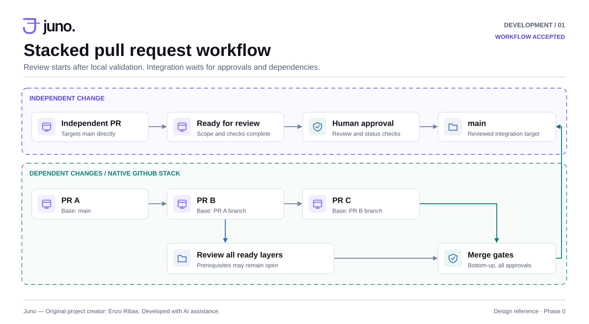

# Stacked pull request workflow

**Status:** Approved workflow. The depicted merge gates distinguish review from integration. Repository settings and the definitive merge method still require separate approval. Updated 2026-11-24 by [JUNO-0016](../../../development/tasks/JUNO-0016.md).

The top lane shows independent work against main. The lower lane shows each dependent PR based on its immediate predecessor. All validated layers can be reviewed as soon as their incremental diffs are sound. Integration starts from the lowest outstanding layer and requires human approvals and applicable checks. Manual fallback keeps the same order and verifies ancestry before merging.

See [ADR-0009](../../adr/0009-stacked-pull-requests.md), the [Git workflow](../../../development/git-workflow.md), the [Phase 0 review guide](../../../development/phase-0-review-guide.md), and the [export guide](../../../../scripts/diagrams/README.md). The icons reuse portable Juno diagram stencils from owner-supplied visual references. The layout is illustrative and does not represent current GitHub rule enforcement.

[Draw.io master](juno-stacked-pull-request-workflow.drawio) · [PDF export](juno-stacked-pull-request-workflow.pdf)

Juno — Original project creator: Enzo Ribas. Developed with AI assistance.
