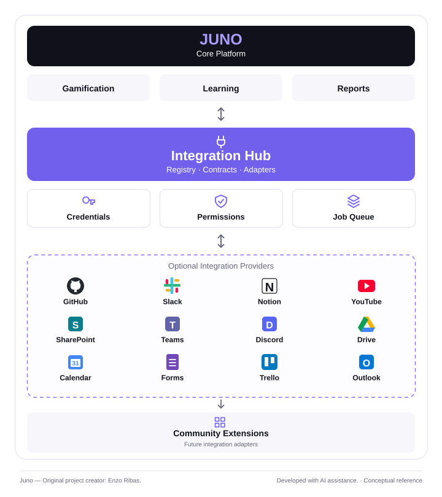

# Integration Hub architecture

**Status:** Approved visual reference for a proposed technical direction. Updated 2026-11-24 under [JUNO-0013](../../../development/tasks/JUNO-0013.md).

The diagram preserves the core platform header, three domain blocks, purple Integration Hub, infrastructure cards, four-column provider grid and dashed optional boundary, and community extensions. Bidirectional connectors depict conceptual interactions. They do not establish transport contracts, polling behavior, or permission grants. The optional providers and future adapters remain planned. See [ADR-0006](../../adr/0006-optional-integrations.md), [ADR-0007](../../adr/0007-integration-adapters.md) and the [integration architecture](../../../integrations/integration-architecture.md).

All shapes, labels, groups, connectors, and local vector icons are editable. Provider marks are owner-supplied illustrations and approximations. Names and marks belong to their respective providers. Verify official asset terms separately before runtime use. The recreation uses Segoe UI in place of Inter, slightly darkens the Hub panel to `#7060EB` for 4.60:1 white-text contrast, and spells out AI attribution. These changes preserve the approved hierarchy and the Juno brand palette.

See the [Draw.io master](juno-integration-hub-architecture.drawio), [PDF export](juno-integration-hub-architecture.pdf), [original SVG](references/juno-integration-hub-architecture.svg), and [original PDF](references/juno-integration-hub-architecture.pdf). Regenerate using the [export guide](../../../../scripts/diagrams/README.md).

Juno — Original project creator: Enzo Ribas. Developed with AI assistance.
