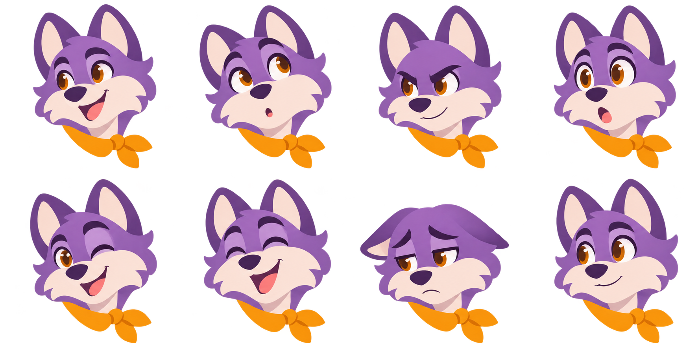
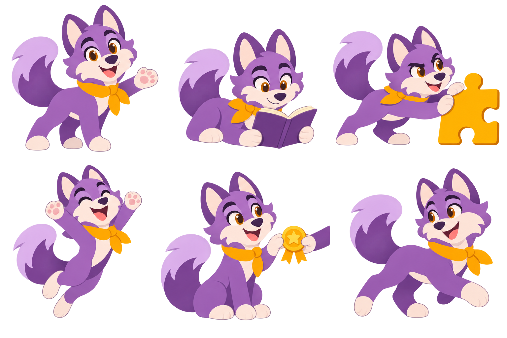
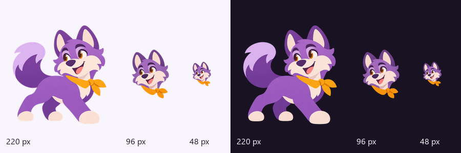

# Juno the wolf pup

The maintainer selected the following eight-expression portrait sheet as the face reference for JUNO-0054. Its amber eyes, short lavender cheek tufts, cream muzzle and golden neckerchief define the character across placements. The [full-body primary](character/juno.png) adds a curved, pale-tipped tail and a forward step with a backward glance. Both assets belong to the same visual direction.

## Choose a pose for a product moment

| Moment                               | Artwork                                        | Intended use                                                     |
| ------------------------------------ | ---------------------------------------------- | ---------------------------------------------------------------- |
| First visit or invitation accepted   | [Welcome](character/poses/welcome.png)         | The raised paw accompanies the greeting and the next action.     |
| Documentation and onboarding lessons | [Study](character/poses/study.png)             | The open book introduces a tutorial or a worked example.         |
| Team setup and collaboration         | [Collaborate](character/poses/collaborate.png) | The puzzle piece accompanies an invitation to work together.     |
| Challenge or milestone completed     | [Celebrate](character/poses/celebrate.png)     | Use the airborne pose after confirmed completion.                |
| Recognition and achievements         | [Recognition](character/poses/recognition.png) | Place the medal beside the actual award name and recipient.      |
| Dashboard guidance or a walkthrough  | [Guide](character/poses/guide.png)             | Put the relevant link or instruction beside the backward glance. |

## Expressions and construction

Read the expression board left to right. The top row shows [happy](character/expressions/happy.png), [curious](character/expressions/curious.png), [focused](character/expressions/focused.png) and [surprised](character/expressions/surprised.png). The second row shows [encouraging](character/expressions/encouraging.png), [celebrating](character/expressions/celebrating.png), [disappointed](character/expressions/disappointed.png) and [neutral](character/expressions/neutral.png). Use curiosity to introduce an explanation. Reserve disappointment for a story in which Juno experiences a setback. Access denials, validation errors and missed goals should use clear, neutral text.

The [turnaround](character/views.png) includes [front](character/views/front.png), [side](character/views/side.png), [back](character/views/back.png) and [three-quarter](character/views/three-quarter.png) views. Follow the ear roots, rounded muzzle, brow line and cheek tufts through a turn. The scarf wraps below the muzzle and the tail has one pale tip. Preserve the pose-specific perspective of the scarf knot. Use large color areas for the purple coat, cream markings and amber accent. Keep future depth treatments restrained and crisp.

## Placement and accessibility

Use the full body where posture matters. At compact sizes use the head and scarf. This proof shows the full body at 220 px and the same portrait at 96 and 48 px on the two V2 surfaces. At 48 px the ears and scarf remain distinctive; eye direction is subtle. Preserve space around the ears, paws and tail. Keep tenant accents on surrounding surfaces so the mascot stays recognizable.

Keep status, instructions, permissions and navigation available in text. Decorative art beside equivalent copy gets empty alternative text. When the picture carries information, describe its action in the surrounding locale, for example “Juno offers a medal” or “Juno oferece uma medalha”. Keep the [official identity](../brand-identity.md) and the [Design System V2](../design-system-v2-implementation.md) as the authority for logos and interface controls.

## Files, provenance and editing

The PNGs under [character](character/) retain transparency. Individual poses, expressions and views are trimmed for placement. Use the [Photoshop master](character/juno-character-library.psd) to recover their shared sheet registration. Toggle one top-level group at a time. The primary illustration separates the neckerchief and eye regions for localized edits. Each additional expression, pose and view has an independent raster layer. Moving a limb into a new pose requires artistic reconstruction beneath overlaps.

For a fresh primary PNG export, use the original 1312 × 1199 canvas. Keep nonzero alpha within five pixels (Euclidean distance) of pixels with alpha of at least 16/255, then retain the largest eight-connected nonzero component. Preserve RGB and the original opacity of every retained pixel. The resulting nonzero bounds are (72, 26) through (1167, 1187), inclusive.

The expression sheet is the exact PNG supplied by the maintainer. The primary and companion sheets were produced using reference-guided OpenAI image generation in the Juno design workflow. Agent 02 prepared transparent sprites, removed low-opacity backing from the pose sheet and assembled the library in desktop Photoshop. The earlier [concept exploration](concepts/v1/concept-board-v1.png) predates the wolf decision and is historical research. This package documents visual assets for review. Application placement requires separate maintainer acceptance.
