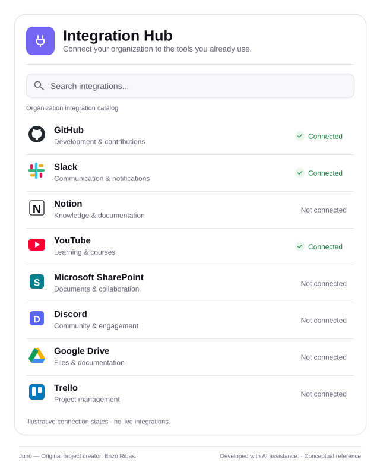

# Integration Hub interface mockup

**Status:** Approved visual reference. A static design for the future Integration Hub, last updated 2026-11-24 under [JUNO-0012](../../development/tasks/JUNO-0012.md).

The mockup preserves the approved heading, subtitle, search, eight provider rows, green status indicators, and row order. GitHub, Slack and YouTube display the illustrative Connected state. Real provider availability and each tenant's connection state will be separate. The future implementation must support tenant branding, accessible keyboard and screen-reader use, responsive layouts, English and Brazilian Portuguese, provider search, configuration and lifecycle management. See the [product specification](../../product/integration-hub.md), [ADR-0006](../../architecture/adr/0006-optional-integrations.md), and [ADR-0008](../../architecture/adr/0008-editable-diagrams.md).

The owner-supplied provider illustrations were recreated as local vector stencils and editable glyphs. They identify providers in the mockup. Provider names and marks belong to their respective owners. The supplied marks include approximations. Verify official asset terms before shipping runtime artwork.

The editable recreation uses Segoe UI with sans-serif fallback in place of the source PDF's Inter and spells out the AI credit in the footer. The icon group, search, rows, separators, and status labels are independently editable. See the [Draw.io master](juno-integration-hub-ui.drawio), [PDF export](juno-integration-hub-ui.pdf), [original SVG](references/juno-integration-hub-ui.svg), and [original PDF](references/juno-integration-hub-ui.pdf). Regenerate via the [diagram export guide](../../../scripts/diagrams/README.md).

Juno — Original project creator: Enzo Ribas. Developed with AI assistance.
