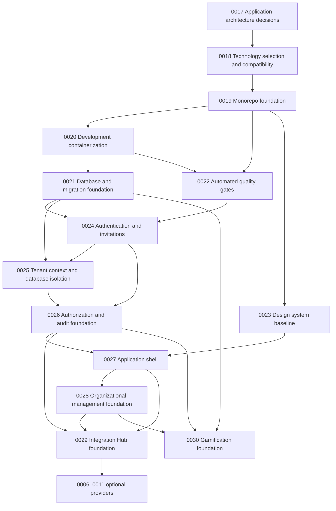

# Phase 1 task dependency graph

The owner authorized a dependency-driven exception to FIFO in the [Phase 1 brief](history/JUNO-0014-request.md). Register the prerequisites separately. Move the new foundation ahead of blocked provider work while preserving all original provider identifiers and relative order. Eligibility requires approved prerequisites and actual validation.

| Task                            | Focused scope                          | Required earlier tasks                                                             |
| ------------------------------- | -------------------------------------- | ---------------------------------------------------------------------------------- |
| [JUNO-0017](tasks/JUNO-0017.md) | Application architecture decisions     | [0015](tasks/JUNO-0015.md)                                                         |
| [JUNO-0018](tasks/JUNO-0018.md) | Technology selection and compatibility | [0017](tasks/JUNO-0017.md)                                                         |
| [JUNO-0019](tasks/JUNO-0019.md) | Monorepo foundation                    | [0018](tasks/JUNO-0018.md)                                                         |
| [JUNO-0020](tasks/JUNO-0020.md) | Development containerization           | [0019](tasks/JUNO-0019.md)                                                         |
| [JUNO-0021](tasks/JUNO-0021.md) | Database and migration foundation      | [0020](tasks/JUNO-0020.md)                                                         |
| [JUNO-0022](tasks/JUNO-0022.md) | Automated quality gates                | [0019](tasks/JUNO-0019.md), [0020](tasks/JUNO-0020.md)                             |
| [JUNO-0023](tasks/JUNO-0023.md) | Design system baseline                 | [0019](tasks/JUNO-0019.md)                                                         |
| [JUNO-0024](tasks/JUNO-0024.md) | Authentication and invitations         | [0021](tasks/JUNO-0021.md), [0022](tasks/JUNO-0022.md)                             |
| [JUNO-0025](tasks/JUNO-0025.md) | Tenant context and database isolation  | [0021](tasks/JUNO-0021.md), [0024](tasks/JUNO-0024.md)                             |
| [JUNO-0026](tasks/JUNO-0026.md) | Authorization and audit foundation     | [0024](tasks/JUNO-0024.md), [0025](tasks/JUNO-0025.md)                             |
| [JUNO-0027](tasks/JUNO-0027.md) | Application shell                      | [0023](tasks/JUNO-0023.md), [0026](tasks/JUNO-0026.md)                             |
| [JUNO-0028](tasks/JUNO-0028.md) | Organizational management foundation   | [0027](tasks/JUNO-0027.md)                                                         |
| [JUNO-0029](tasks/JUNO-0029.md) | Integration Hub foundation             | [0026](tasks/JUNO-0026.md), [0027](tasks/JUNO-0027.md), [0028](tasks/JUNO-0028.md) |
| [JUNO-0030](tasks/JUNO-0030.md) | Gamification foundation                | [0021](tasks/JUNO-0021.md), [0026](tasks/JUNO-0026.md), [0028](tasks/JUNO-0028.md) |

## Provider gates

All providers require [JUNO-0029](tasks/JUNO-0029.md) and their feasibility and access approvals. GitHub Projects additionally requires a reviewed GitHub installation strategy. YouTube requires a learning content and completion contract. SharePoint and Notion require authorized document-reference contracts. Slack requires tenant-scoped notifications and event delivery. Record those specific contracts in the provider PR. Pending Phase 1 decisions remain separate from provider requirements.
