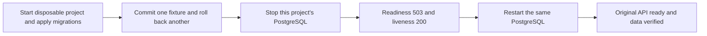

# Database outage and recovery validation

Use this local validator to check the behavior of Juno when its PostgreSQL service stops and restarts. It runs against the existing Compose topology and uses a new project, a new database volume, and synthetic credentials. It requires Node 24, Docker Engine with Linux containers, and the Compose plugin.

```sh
node scripts/quality/validate-database-recovery.mjs
```

The validator defaults to loopback ports 18510 and 18511. Set `JUNO_WEB_PORT` and `JUNO_API_PORT` to distinct free ports if needed. It loads the tracked environment example and supplies its own credentials. The project name is printed before startup. The script removes the project and its synthetic volume after the checks.



The validator checks the migration journal before and after the incident, verifies committed and rolled-back data, and runs the existing migration service again. It asserts that the original API container recovers and that the HTTP readiness failure has a generic response. See the [editable container topology](../architecture/diagrams/juno-containerized-development.md) for the existing network and service boundaries.

## Scope of evidence

This test covers a controlled stop and restart of the database on the same volume. It leaves abrupt process termination, an interrupted migration, production failover, and backup restore to separate validation. Run the existing [Compose regression suite](juno-0022-platform-validation.md) for application and authorization checks.


## Validated outcome

On 2026-11-24, isolated Linux amd64 Compose on the Windows development host built both applications, applied five migrations, and reached readiness. Stopping PostgreSQL returned HTTP 503 with a generic body from readiness and HTTP 200 from liveness. After database restart, readiness returned HTTP 200 on the original API container. The migration journal and committed fixture persisted, the rolled-back fixture remained absent, and a migration rerun applied no additional entries. The runner removed its disposable resources. Duplicate ports were rejected before startup.
